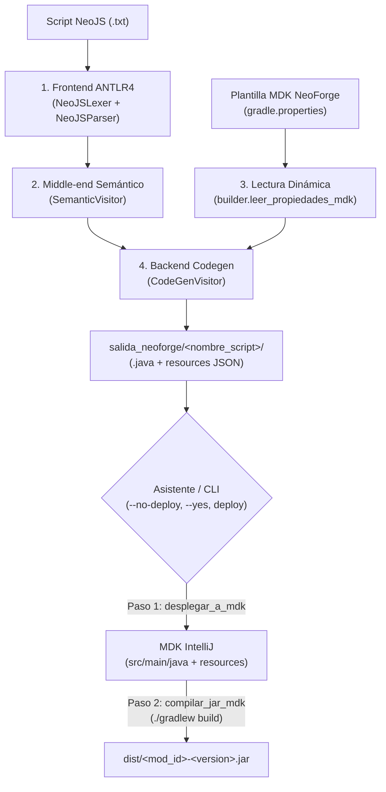

# Arquitectura y Guía Técnica de NeoJS

> Documento de referencia técnica y guía de extensibilidad para desarrolladores y agentes de IA que trabajen sobre **NeoJS** (compilador DSL declarativo para mods de Minecraft **NeoForge 1.21.1**).

---

## 1. Resumen Ejecutivo

**NeoJS** es un compilador *source-to-source* y automatizador *End-to-End* escrito en Python y **ANTLR4**. Toma un script declarativo (`.txt`) que define ítems, armas, recetas, entidades (mobs) y modificaciones sobre contenido vanilla, lo valida sintáctica y semánticamente, transpila las clases Java 21 y recursos JSON compatibles con **NeoForge 1.21.1**, inyecta los archivos generados en una plantilla MDK de Gradle y produce un archivo `.jar` listo para instalar en Minecraft.

### Flujo completo (del `.txt` al `.jar`)



1. **Frontend Léxico y Sintáctico (`NeoJS.g4` / `gen/`):** Tokeniza y construye el AST (`program -> declaration*`). Si existen errores de sintaxis, detiene la compilación antes de analizar semántica.
2. **Middle-end Semántico (`semantic/semantic_visitor.py`):** Recorre el AST manteniendo tablas de símbolos y validando las **10 reglas de negocio** del DSL (duplicados, tipos, rangos, namespaces, referencias cruzadas en recetas e inconsistencias lógicas).
3. **Lectura Dinámica del MDK (`builder.leer_propiedades_mdk`):** Lee `gradle.properties` del MDK destino para obtener en tiempo de ejecución `mod_id`, `mod_group_id` (paquete base Java) y `mod_version`. **No hay identificadores de mod hardcodeados en el compilador.**
4. **Backend / Generación de Código Aislada (`codegen/code_gen_visitor.py`):** Emite en `salida_neoforge/<nombre_script>/` las clases Java y recursos JSON parametrizados con el `mod_id` y `base_package` recibidos, sin sobrescribir salidas de otros scripts.
5. **Asistente Interactivo y Puente MDK (`main.py` + `builder.py`):**
   * **Paso 1 (`desplegar_a_mdk`):** Pregunta si se desea mover y reemplazar la lógica en el MDK de IntelliJ (limpia `src/main/java/` y `assets/`/`data/`, preservando `META-INF/neoforge.mods.toml`, e inyecta la salida).
   * **Paso 2 (`compilar_jar_mdk`):** Si se desplegó al MDK, pregunta si se desea ejecutar `./gradlew build` y extraer el `.jar` compilado en `dist/`.
   * También puede operarse sin prompts mediante `--yes`/`-y`, `--no-deploy` o los subcomandos `deploy` y `list`.

---

## 2. Estructura del Proyecto y Desglose de Archivos

```text
NeoJS/
├── NeoJS.g4                     # Gramática ANTLR4 (lexer + parser)
├── antlr-4.13.2-complete.jar    # Compilador ANTLR4 para regenerar gen/
├── main.py                      # CLI (compile, deploy, list) y asistente interactivo
├── builder.py                   # Puente desacoplado con el MDK de NeoForge y Gradle
├── gen/                         # Código Python autogenerado por ANTLR4
├── semantic/
│   └── semantic_visitor.py      # Analizador semántico (10 reglas)
├── codegen/
│   └── code_gen_visitor.py      # Generador de Java 21 y JSON para NeoForge 1.21.1
├── tests/
│   ├── correct/                 # Casos válidos (correct1..10.txt, general_mod.txt)
│   └── errors/                  # Casos inválidos (error1..10.txt)
├── salida_neoforge/             # Salidas intermedias aisladas por script
│   └── <nombre_script>/         # Ej. general_mod/ (Java + resources/)
├── dist/                        # Entrega final de los .jar compilados
├── AGENT.md                     # Contexto, reglas permanentes y hoja de ruta
└── ARCHITECTURE.md              # Este documento
```

### 2.1. `NeoJS.g4` y `gen/` (Frontend ANTLR4)

* **Reglas sintácticas (`program`, `declaration`):** Soporta 5 bloques de alto nivel:
  * `itemDecl`: `item <ID> { <attrList> }`
  * `weaponDecl`: `weapon <ID> { <attrList> }`
  * `recipeDecl`: `recipe <ID> { <attrList> }`
  * `mobDecl`: `mob <ID> { <attrList> }`
  * `modifyDecl`: `modify (item | mob) <ID> { <attrList> }`
* **Pares clave-valor (`attrList` / `attr`):** Cada bloque contiene una o más sentencias `<ID>: <value>;`.
* **Tipos léxicos (`value`):**
  * `NUMBER`: enteros o decimales, con signo negativo opcional (`-?[0-9]+(\.[0-9]+)?`).
  * `PERCENTAGE`: número seguido de `%` (`25%`).
  * `STRING`: texto entre comillas dobles (`"..."`).
  * `TRUE` / `FALSE`: literales booleanos (`true` / `false`).
  * `ID`: identificadores simples o con namespace (`minecraft:diamond`, `LingoteTitanio`).
* **Regeneración de `gen/`:** Si modificas `NeoJS.g4`, regenera los archivos en `gen/` (`NeoJSLexer.py`, `NeoJSParser.py`, `NeoJSVisitor.py`, tokens e `.interp`) ejecutando:
  ```bash
  java -jar antlr-4.13.2-complete.jar -Dlanguage=Python3 -visitor NeoJS.g4 -o gen
  ```

### 2.2. `semantic/semantic_visitor.py` (Middle-end)

Implementa `SemanticVisitor(NeoJSVisitor)` con:
* **Tablas de símbolos:** `items_declarados`, `weapons_declaradas`, `recipes_declaradas`, `mobs_declarados` y `modificaciones`.
* **Diccionarios declarativos de validación:**
  * `reglas_tipos`: mapea cada atributo permitido a su tipo esperado (`STRING`, `ID`, `NUMBER`, `BOOLEAN`, `PERCENTAGE`).
  * `atributos_por_contexto`: restringe qué atributos acepta cada bloque (`item`, `weapon`, `recipe`, `mob`, `modify_mob`, `modify_item`).
  * Conjuntos de dominio: `rarities_validas` (`common`, `uncommon`, `rare`, `epic`) y `behaviors_validos` (`aggressive`, `passive`, `neutral`).

| # | Código interno | Regla validada |
|---|----------------|----------------|
| 1 | Identificador Duplicado | Evita colisiones de nombres entre `item`/`weapon`, entre `recipe` y entre `mob`. |
| 2 | Tipo Incompatible | Valida que cada atributo coincida con su tipo en `reglas_tipos`. |
| 3 | Atributo No Reconocido / Fuera de Contexto | Rechaza atributos inexistentes o no listados en `atributos_por_contexto`. |
| 4 | Propiedad Duplicada | Impide declarar el mismo atributo dos veces en un mismo bloque. |
| 5 | Enumeración Inválida | Restringe `rarity` y `behavior` a sus valores permitidos. |
| 6 | Rango Numérico / Porcentaje Inválido | `stack_size` entero en `[1, 64]`; `hp`, `durability`, `hitbox_w`, `hitbox_h`, `scale`, `amount` `> 0`; `damage`, `defense`, `armor` `>= 0`; `crit_chance` en `[0%, 100%]`. |
| 7 | Atributo Obligatorio Faltante | `weapon` exige `damage`; `recipe` exige `result` e `ingredients`. |
| 8 | Referencia No Declarada | En `_validar_referencias_recetas()`, comprueba que `result` y los ingredientes sin `:` existan en `items_declarados \| weapons_declaradas`. |
| 9 | Namespace Faltante | `modify`, `base_item` y `base_model` deben incluir `:` (ej. `minecraft:zombie`). |
| 10 | Inconsistencia de Comportamiento | Un `mob` con `behavior: "passive"` no puede tener `damage > 0`. |

### 2.3. `codegen/code_gen_visitor.py` (Backend)

Implementa `CodeGenVisitor(NeoJSVisitor)`:
* **Constructor obligatorio sin hardcodeo:** `CodeGenVisitor(mod_id: str, base_package: str)` exige explícitamente ambos parámetros (provenientes del `gradle.properties` del MDK) y lanza `ValueError` si faltan.
* **Artefactos Java generados (bajo `self.base_package`):**
  * `items/<Nombre>Item.java` (`package <base_package>.items`): extiende `Item`, configura `stacksTo`, `rarity` y `.fireResistant()`.
  * `weapons/<Nombre>Weapon.java` (`package <base_package>.weapons`): extiende `SwordItem` usando `SimpleTier`, atributos de ataque y aplicación de `MobEffects` en `hurtEnemy(...)`.
  * `mobs/<Nombre>Entity.java` (`package <base_package>.mobs`):
    * Si `behavior == "aggressive"`: extiende `Zombie` y usa `Zombie.createAttributes()`.
    * Si `behavior != "aggressive"` (pasivo/neutral): extiende `WanderingTrader`, importa `net.minecraft.world.entity.Mob` y usa `Mob.createMobAttributes()` (en Minecraft 1.21.1 `WanderingTrader` no define un método estático `createAttributes()` propio).
  * `events/VanillaOverridesHandler.java` (`package <base_package>.events`): suscrito con `@EventBusSubscriber(modid = NeoJSMod.MOD_ID)` a `EntityJoinLevelEvent` para aplicar en el servidor los `modify mob`.
  * `NeoJSMod.java` (`package <base_package>`): clase `@Mod(NeoJSMod.MOD_ID)` con:
    * Registros diferidos: `ITEMS` (`DeferredRegister.Items`), `ENTITY_TYPES` (`DeferredRegister<EntityType<?>>`) y `CREATIVE_TABS` (`DeferredRegister<CreativeModeTab>`).
    * **Las 3 partes obligatorias por cada mob:**
      1. Registro del `EntityType` en `ENTITY_TYPES` + su `DeferredSpawnEggItem` en `ITEMS`.
      2. Suscriptor `ModBusEvents` (`@EventBusSubscriber(modid = NeoJSMod.MOD_ID, bus = EventBusSubscriber.Bus.MOD)`) para `EntityAttributeCreationEvent`.
      3. Suscriptor cliente `ClientModEvents` (`@EventBusSubscriber(modid = NeoJSMod.MOD_ID, bus = EventBusSubscriber.Bus.MOD, value = Dist.CLIENT)`) para `EntityRenderersEvent.RegisterRenderers` (`ZombieRenderer::new` o `WanderingTraderRenderer::new`), indispensable para evitar crashes (`exit value 255`) al renderizar entidades personalizadas en el cliente.
* **Recursos JSON generados (bajo `resources/`):**
  * `resources/assets/<mod_id>/models/item/<short_id>.json` (y `<short_id>_spawn_egg.json`).
  * `resources/assets/<mod_id>/lang/en_us.json` y `es_es.json`.
  * `resources/data/<mod_id>/recipe/<short_id>.json` (formato `minecraft:crafting_shaped` de 1.21 con `"result": {"id": ..., "count": ...}`).
* **Limpieza intermedia (`emitir(carpeta_salida)`):** Antes de escribir en `salida_neoforge/<nombre_script>/`, elimina exclusivamente esa subcarpeta específica con `shutil.rmtree` y la recrea limpia con `os.makedirs`, preservando intactas las subcarpetas de otros scripts compilados previamente.

### 2.4. `builder.py` (Puente MDK y Gradle Desacoplado)

Conecta `salida_neoforge/<nombre_script>/` con la plantilla MDK de NeoForge 1.21.1 (`DEFAULT_MDK_PATH = "/home/bookie/Proyectos/Neoforge-myMod-1.21.1"`):
* `leer_propiedades_mdk(mdk_path)`: parsea `<mdk_path>/gradle.properties` y retorna `mod_id`, `mod_group_id` y `mod_version`.
* `limpiar_mdk(mdk_path, base_package)`:
  * Elimina todo `<mdk_path>/src/main/java/` (borrando clases de ejemplo como `ExampleMod.java` o `BookieMod.java` para evitar colisión de `@Mod`) y recrea `<mdk_path>/src/main/java/<ruta_del_paquete>/`.
  * En `<mdk_path>/src/main/resources/` elimina únicamente `assets/` y `data/`, **preservando intactos `META-INF/neoforge.mods.toml`** y demás recursos estáticos.
* `copiar_fuentes_a_mdk(carpeta_salida, mdk_path, base_package)`: traslada `resources/` a `src/main/resources/` y los `.java` / subpaquetes a `src/main/java/<ruta_del_paquete>/`.
* `ejecutar_gradle_y_extraer_jar(mdk_path, mod_id, mod_version, dist_dir="dist")`: asigna permisos `0o755` a `./gradlew`, ejecuta `./gradlew build`, localiza `<mod_id>-<mod_version>.jar` en `build/libs/` y lo copia a `dist/`.
* `desplegar_a_mdk(carpeta_salida, mdk_path=DEFAULT_MDK_PATH, props=None) -> dict`: valida `carpeta_salida`, lee `props` si no se proveen, ejecuta `limpiar_mdk` + `copiar_fuentes_a_mdk` y retorna `props`. Permite actualizar el código en IntelliJ sin disparar Gradle.
* `compilar_jar_mdk(mdk_path=DEFAULT_MDK_PATH, dist_dir="dist", props=None) -> str`: lee `props` si no se proveen, ejecuta `ejecutar_gradle_y_extraer_jar` y retorna la ruta del `.jar` generado en `dist/`.
* `construir_mod(...)`: fachada retrocompatible que invoca secuencialmente `desplegar_a_mdk(...)` y `compilar_jar_mdk(...)`.

### 2.5. `main.py`, `tests/`, `salida_neoforge/` y `dist/`

* **`main.py`:** Interfaz CLI basada en `argparse` con compatibilidad directa y asistente interactivo de 2 pasos (manejando `KeyboardInterrupt` / `EOFError` sin tracebacks):
  ```bash
  # Compilación (modo por defecto o subcomando explícito 'compile')
  python main.py <ruta_script.txt> [--mdk RUTA] [--yes | -y] [--no-deploy]
  python main.py compile <ruta_script.txt> [--mdk RUTA] [--yes | -y] [--no-deploy]

  # Desplegar una compilación ya guardada hacia el MDK (IntelliJ)
  python main.py deploy <ruta_carpeta> [--mdk RUTA] [--build] [--yes | -y]

  # Listar compilaciones disponibles en salida_neoforge/
  python main.py list
  ```
  * `--yes` / `-y`: omite confirmaciones interactivas y ejecuta despliegue al MDK + compilación del `.jar`.
  * `--no-deploy`: genera `salida_neoforge/<nombre_script>/` y termina sin tocar el MDK.
  * `--build` (en `deploy`): ejecuta `./gradlew build` automáticamente tras copiar al MDK.
* **`tests/correct/`:** Incluye `correct1.txt`..`correct10.txt` y `general_mod.txt` (prueba integral con 4 ítems, 4 armas, 4 recetas, 4 mobs y 6 modificaciones vanilla).
* **`tests/errors/`:** Incluye `error1.txt`..`error10.txt`, uno por cada regla semántica validada.
* **`salida_neoforge/<nombre_script>/`:** Subcarpetas aisladas por nombre base del script fuente (`Path(ruta_archivo).stem`), listas para desplegarse con `python main.py deploy salida_neoforge/<nombre_script>`.
* **`dist/`:** Directorio final donde queda el archivo `.jar` compilado por Gradle (ej. `dist/bookiemod-1.0.0.jar`).

---

## 3. Guía Práctica de Extensibilidad (Paso a Paso)

Cada vez que añadas una nueva construcción o capacidad al DSL de NeoJS, sigue siempre este orden de 4 pasos:

1. **Gramática (`NeoJS.g4`) + Regenerar `gen/`:** Añade tokens y reglas sintácticas, luego regenera con `antlr-4.13.2-complete.jar`.
2. **Semántica (`semantic/semantic_visitor.py`):** Registra la nueva tabla de símbolos, los atributos en `reglas_tipos` / `atributos_por_contexto`, y crea el método `visit<NuevaRegla>Decl`.
3. **Generación de código (`codegen/code_gen_visitor.py`):** Implementa `visit<NuevaRegla>Decl`, emite los `.java` y JSON en `self.archivos_salida`, y registra los elementos en `finalizar()` dentro de `NeoJSMod.java`.
4. **Mapeo en MDK (`builder.py`):** Verifica que `limpiar_mdk` y `copiar_fuentes_a_mdk` limpien y copien cualquier carpeta nueva dentro de `resources/assets/<mod_id>/` o `resources/data/<mod_id>/` (actualmente todo lo que esté bajo `resources/assets/` y `resources/data/` ya se limpia y copia automáticamente).

---

### Caso Práctico 1: Agregar Bloques (`block`)

Objetivo: soportar bloques como:
```text
block BloqueTitanio {
    name: "Bloque de Titanio";
    hardness: 5.0;
    resistance: 12.0;
    light_level: 8;
    base_item: minecraft:iron_block;
}
```

1. **`NeoJS.g4`:**
   * Agrega el token `TK_BLOCK : 'block' ;` y la regla `blockDecl : TK_BLOCK ID LBRACE attrList RBRACE ;` dentro de `declaration`.
   * Regenera el parser: `java -jar antlr-4.13.2-complete.jar -Dlanguage=Python3 -visitor NeoJS.g4 -o gen`.

2. **`semantic/semantic_visitor.py`:**
   * En `__init__`, inicializa `self.bloques_declarados = {}`.
   * En `reglas_tipos`, agrega `"hardness": "NUMBER"`, `"resistance": "NUMBER"`, `"light_level": "NUMBER"`.
   * En `atributos_por_contexto`, agrega `"block": {"name", "hardness", "resistance", "light_level", "base_item", "asset_path"}`.
   * Implementa `visitBlockDecl` validando colisión de ID (Error #1) y que `hardness >= 0`, `resistance >= 0` y `0 <= light_level <= 15` (Error #6).

3. **`codegen/code_gen_visitor.py`:**
   * En `visitBlockDecl`, genera `blocks/<Nombre>Block.java` (`package {self.base_package}.blocks;`) extendiendo `Block`:
     ```java
     public class {nombre}Block extends Block {{
         public {nombre}Block() {{
             super(BlockBehaviour.Properties.of()
                 .strength({hardness:.1f}F, {resistance:.1f}F)
                 .lightLevel(state -> {light_level}));
         }}
     }}
     ```
   * Genera los 3 JSON de bloque usando `self.mod_id`:
     * `resources/assets/{self.mod_id}/blockstates/{short_id}.json` (apuntando a `"{self.mod_id}:block/{short_id}"`).
     * `resources/assets/{self.mod_id}/models/block/{short_id}.json` (con `"parent": "minecraft:block/cube_all"`).
     * `resources/assets/{self.mod_id}/models/item/{short_id}.json` (con `"parent": "{self.mod_id}:block/{short_id}"`).
   * Añade la traducción `block.{self.mod_id}.{short_id}` en `self.traducciones`.
   * En `finalizar()` (`NeoJSMod.java`), agrega:
     * `public static final DeferredRegister.Blocks BLOCKS = DeferredRegister.createBlocks(MOD_ID);`
     * Registro del bloque (`BLOCKS.register(...)`) y su `BlockItem` (`ITEMS.registerSimpleBlockItem(...)`).
     * `BLOCKS.register(modEventBus);` en el constructor de `NeoJSMod` y `output.accept(...)` en `NEOJS_TAB`.

4. **`builder.py`:**
   * `limpiar_mdk` ya limpia `resources/assets/` y `resources/data/`, y `copiar_fuentes_a_mdk` copia recursivamente `salida_neoforge/blocks/` hacia `src/main/java/<base_package>/blocks/` y `blockstates/` + `models/block/` hacia `src/main/resources/assets/<mod_id>/`. No requiere cambios adicionales salvo que quieras limpiar otra carpeta fuera de `assets`/`data`.

---

### Caso Práctico 2: Agregar Armaduras (`armor`)

Objetivo: soportar piezas de armadura como:
```text
armor CascoTitanio {
    name: "Casco de Titanio";
    slot: "helmet";
    defense: 5;
    durability: 600;
    base_item: minecraft:diamond_helmet;
}
```

1. **`NeoJS.g4`:**
   * Agrega `TK_ARMOR : 'armor' ;` y `armorDecl : TK_ARMOR ID LBRACE attrList RBRACE ;` en `declaration`.
   * Regenera `gen/`.

2. **`semantic/semantic_visitor.py`:**
   * Agrega `self.armaduras_declaradas = {}` y añade `armaduras_declaradas` al chequeo de colisión de IDs en ítems/armas/armaduras (Error #1) y en `_validar_referencias_recetas` (Error #8) para poder craftear armaduras.
   * En `reglas_tipos`, agrega `"slot": "STRING"`, `"toughness": "NUMBER"`.
   * En `atributos_por_contexto`, agrega `"armor": {"name", "slot", "defense", "toughness", "durability", "rarity", "fire_immune", "base_item", "asset_path"}`.
   * Valida en `visitArmorDecl` que `slot` pertenezca a `{"helmet", "chestplate", "leggings", "boots"}` (Error #5) y que `slot` y `defense` sean obligatorios (Error #7).

3. **`codegen/code_gen_visitor.py`:**
   * Mapea `slot` al enum `ArmorItem.Type` (`HELMET`, `CHESTPLATE`, `LEGGINGS`, `BOOTS`).
   * En `visitArmorDecl`, genera `armors/<Nombre>Armor.java` (`package {self.base_package}.armors;`) heredando de `ArmorItem` y pasando `ArmorMaterials.DIAMOND` (o un `Holder<ArmorMaterial>` registrado con `DeferredRegister<ArmorMaterial>` si personalizas defensas por material), `ArmorItem.Type.<SLOT>`, y `new Item.Properties().durability(...)`.
   * Llama a `self._generar_modelo_item_json(short_id, base_item, is_handheld=False)` y registra la traducción `item.{self.mod_id}.{short_id}`.
   * En `finalizar()`, importa `{self.base_package}.armors.*`, registra cada pieza en `ITEMS.registerItem(...)` y añádela a `NEOJS_TAB`.

4. **`builder.py`:**
   * `copiar_fuentes_a_mdk` copiará automáticamente la nueva subcarpeta `armors/` hacia `src/main/java/<base_package>/armors/` y sus modelos JSON a `src/main/resources/`.

---

### Caso Práctico 3: Soportar Texturas Personalizadas (`.png`)

Actualmente `item`, `weapon` y `mob` ya aceptan `asset_path` (ej. `"<mod_id>:textures/item/titanium_ingot.png"` o una ruta local como `"assets_custom/titanium_ingot.png"`), pero `_generar_modelo_item_json` aún usa `minecraft:item/<tex_name>` como textura de respaldo. Para soportar `.png` reales empaquetados en el `.jar`:

1. **`NeoJS.g4` y `semantic/semantic_visitor.py`:**
   * No requieren cambios sintácticos porque `asset_path: "STRING"` ya existe en la gramática y en `atributos_por_contexto` para `item`, `weapon` y `mob`.
   * Opcionalmente, en `SemanticVisitor._validar_dominios_comunes`, puedes validar que si `asset_path` apunta a un archivo local (no contiene `:`), el archivo `.png` exista en disco y termine en `.png`.

2. **`codegen/code_gen_visitor.py`:**
   * Crea un diccionario o conjunto de archivos binarios a copiar (`self.assets_binarios = {}`) o copia directamente en `emitir()`.
   * Si `asset_path` es una ruta local existente (por ejemplo `textures/titanium_ingot.png`):
     * Para ítems/armas, determina la ruta destino dentro del mod:
       `resources/assets/{self.mod_id}/textures/item/{short_id}.png`
       y cambia el campo `"textures": {"layer0": f"{self.mod_id}:item/{short_id}"}` dentro de `_generar_modelo_item_json`.
     * Para mobs, copia el `.png` a:
       `resources/assets/{self.mod_id}/textures/entity/{short_id}.png`
       y apunta `CUSTOM_SKIN_TEXTURE` a `ResourceLocation.fromNamespaceAndPath(NeoJSMod.MOD_ID, "textures/entity/{short_id}.png")` (acompañado en `ClientModEvents` de un renderer propio que sobrescriba `getTextureLocation(...)`).
   * Si `asset_path` no apunta a un archivo local en disco, conserva el *fallback* actual (`minecraft:item/...`) para que los scripts sin texturas externas sigan compilando sin errores.

3. **`builder.py`:**
   * `copiar_fuentes_a_mdk` usa `shutil.copytree(origen, resources_dir, dirs_exist_ok=True)`, que copia archivos binarios `.png` sin alterarlos.
   * Por tanto, una vez que `CodeGenVisitor.emitir()` coloque los `.png` bajo `salida_neoforge/<nombre_script>/resources/assets/<mod_id>/textures/...`, `builder.py` los empaquetará automáticamente dentro del `.jar` final en `assets/<mod_id>/textures/...` sin necesidad de modificar `copiar_fuentes_a_mdk`.
   * *Nota:* Si en algún momento añades una carpeta dedicada de texturas fuente en la raíz del proyecto (ej. `assets_src/`), pásala como parámetro opcional a `CodeGenVisitor` o a `desplegar_a_mdk` / `construir_mod` en `builder.py` manteniendo la independencia respecto al `mod_id` leído de `gradle.properties`.

---

## 4. Hoja de Ruta Oficial y Regla de Sincronización Documental

### 4.1. Regla Permanente de Actualización Documental
En **todas las futuras iteraciones** sobre este repositorio es obligatorio mantener `AGENT.md` y `ARCHITECTURE.md` completamente sincronizados con el código real antes de dar por concluida cualquier tarea:
* Actualizar diagramas, firmas de funciones, comandos CLI y tablas de reglas si cambian en el código.
* Conservar intacta la regla de cero hardcodeo (`mod_id` y `base_package` siempre leídos desde `gradle.properties` del MDK).

### 4.2. Hoja de Ruta Oficial (Fases Futuras)
1. **Fase 1 (Próxima):** Texturas personalizadas (`.png`) y escalado visual (`scale` + `PoseStack`) sobre modelos base de entidades en el cliente (`ClientModEvents`).
2. **Fase 2:** Sonidos personalizados (`sounds.json`) y generación natural de mobs en biomas (`neoforge/biome_modifier` con `add_spawns`).
3. **Fase 3:** Integración de **GeckoLib** como dependencia en `build.gradle` del MDK para soportar geometrías 3D personalizadas (`.geo.json`) y animaciones (`.animation.json`) de criaturas complejas.
4. **Fase 4:** Generación de mundo y minerales (`ore` / `worldgen`: `configured_feature`, `placed_feature` y `biome_modifier` de `add_features`).
5. **Fase 5:** Tablas de botín (`loot` / `loot_table` en JSON) y efectos de estado avanzados.
